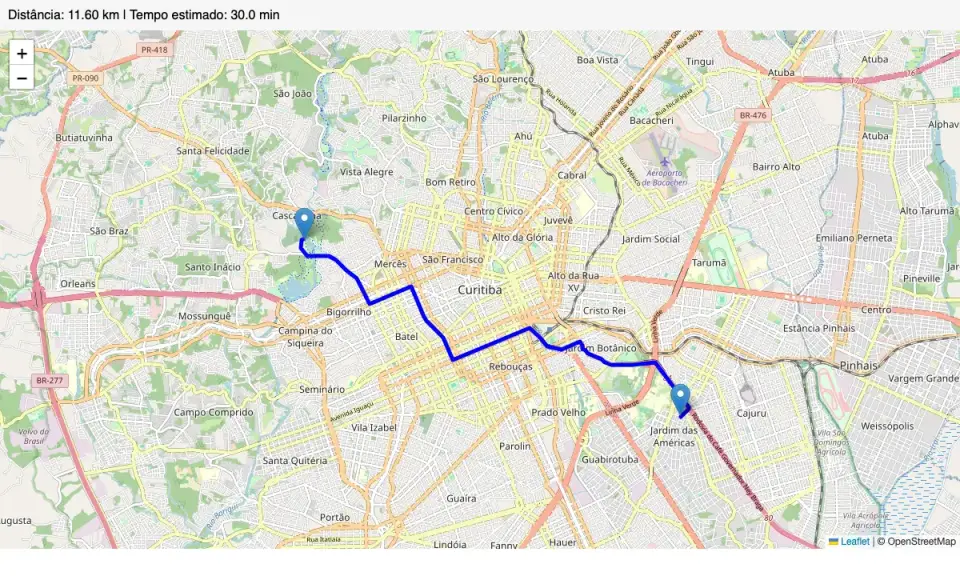
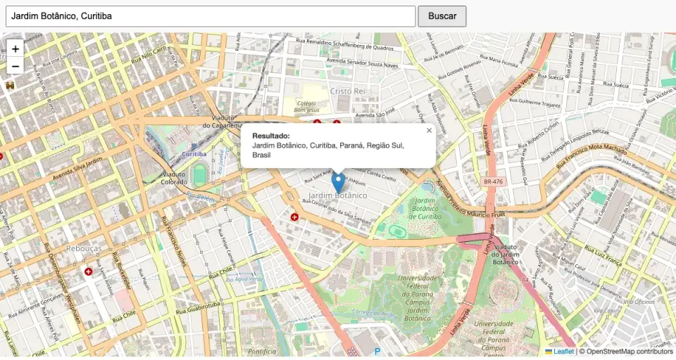
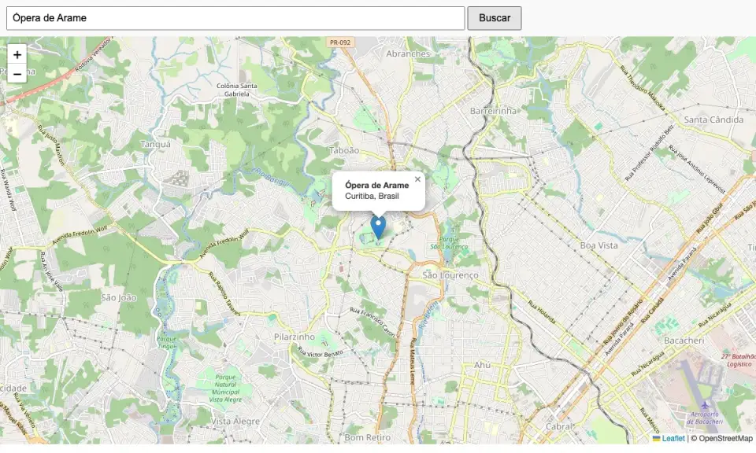
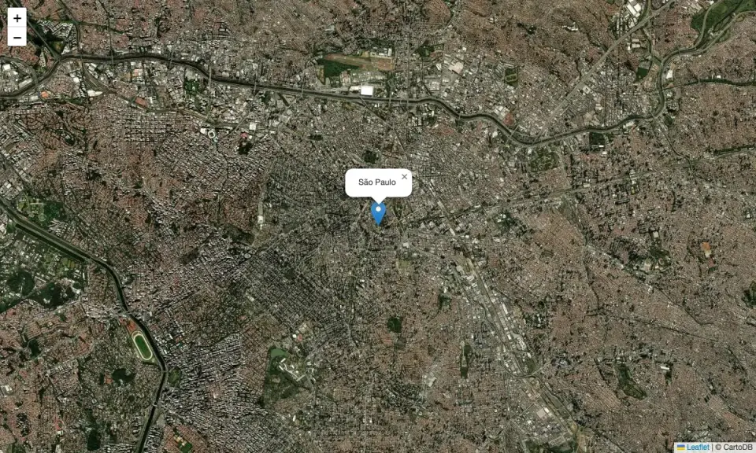
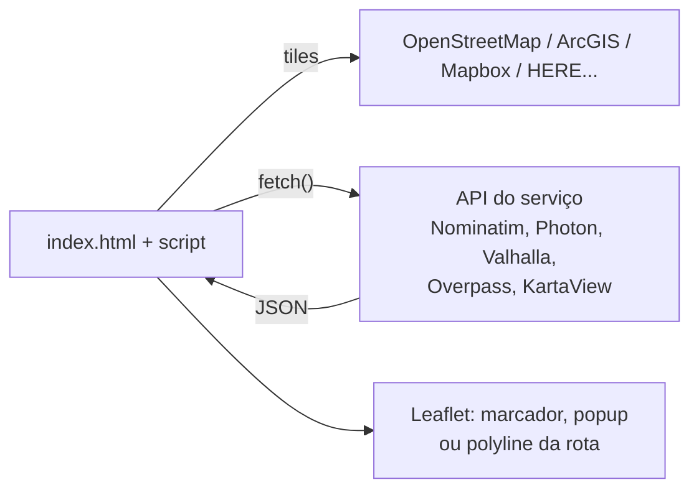

# geo-tech-experiments

Laboratório comparativo de tecnologias de mapas para web: um protótipo pequeno em HTML/JS por biblioteca ou serviço (Leaflet, Mapbox, HERE, Google Maps, CesiumJS, TomTom, Mapillary, AnyChart) e por API aberta do ecossistema OpenStreetMap (Nominatim, Photon, Valhalla, Overpass, KartaView). Cada pasta tem um README próprio com o passo a passo daquela ferramenta.



## Objetivos

- Avaliar o que cada ferramenta oferece (imagens de rua, rotas, camadas, estilos, 3D, geocodificação).
- Fazer protótipos mínimos de integração com HTML e JavaScript.
- Comparar usabilidade, documentação, SDKs e APIs REST.
- Deixar exemplos replicáveis para projetos de mapas.

## Experimentos

| Pasta | Tecnologia | O que o exemplo faz | Precisa de chave? |
|---|---|---|---|
| [`nominatim/`](nominatim/) | Nominatim (OSM) | Busca um endereço e centraliza o mapa Leaflet no resultado | Não |
| [`photon/`](photon/) | Photon (Komoot) | Geocodificação com busca por texto, mesma ideia do Nominatim | Não |
| [`valhalla /`](<valhalla />) | Valhalla | Clique em dois pontos e ele traça a rota de carro, com distância e tempo | Não |
| [`overpasss-turbo/`](overpasss-turbo/) | Overpass API | Consulta os restaurantes de Curitiba no OSM e marca no mapa | Não |
| [`kartaview/`](kartaview/) | KartaView | Clique no mapa e mostra a foto de rua mais próxima | Não |
| [`leafletjs/`](leafletjs/) | Leaflet | Mapa de satélite (ArcGIS World Imagery) com marcador em São Paulo | Não |
| [`anymap-anychart/`](anymap-anychart/) | AnyChart Maps | Mapa coroplético do mundo com o conjunto de dados de exemplo da AnyChart | Não |
| [`mapbox/`](mapbox/) | Mapbox GL JS | 9 estilos: padrão, 3D, claro minimalista, escuro, GPS diurno/noturno, satélite puro, satélite com ruas, trilhas e terreno | Sim (`mapboxgl.accessToken`) |
| [`here-maps/`](here-maps/) | HERE Maps API for JS | 60 exemplos da HERE (marcadores, clusters, rotas, isolinhas, mapas internos, GeoJSON, KML...) | Sim (`here-maps/test-credentials.js`) |
| [`google-maps/`](google-maps/) | Google Maps JavaScript API | Mapa básico | Sim (`key=` no `index.html`) |
| [`cesiumjs/`](cesiumjs/) | CesiumJS 1.114 | Globo 3D com terreno e um pino no centro de São Paulo | Sim (`Cesium.Ion.defaultAccessToken`) |
| [`mapillary/`](mapillary/) | MapillaryJS 4 + Vite | Visualizador de imagens de rua 360° | Sim (`accessToken` em `main.js`) |
| [`tomtom-maps-sdk/`](tomtom-maps-sdk/) | TomTom Maps SDK for Web | Cópia dos exemplos oficiais da TomTom (V5 e V6) | Sim |

| Nominatim | Photon | Leaflet (satélite) |
| --- | --- | --- |
|  |  |  |

## Como funciona

Quase todos os exemplos seguem o mesmo desenho: uma página estática que carrega a biblioteca por CDN e conversa direto com a API do serviço, sem backend.



No Valhalla, a rota volta como polyline codificada com precisão 6; o `index.html` tem a função `decodePolyline` que transforma em coordenadas para o Leaflet.

## Como rodar

Os exemplos são estáticos. Na raiz do repositório:

```bash
python3 -m http.server 8000
```

E abra, por exemplo:

- http://localhost:8000/nominatim/
- http://localhost:8000/photon/
- http://localhost:8000/valhalla%20/ (a pasta tem um espaço no fim do nome)
- http://localhost:8000/overpasss-turbo/
- http://localhost:8000/leafletjs/leaflet-test/
- http://localhost:8000/here-maps/route-a-to-b/ (depois de colocar a chave em `here-maps/test-credentials.js`)

O Live Server do VS Code ou `npx http-server` também servem.

Exceções:

- **Mapillary** usa import de pacote npm, então precisa do Vite: `cd mapillary && npm install && npm run dev`.
- **Exemplos com chave**: troque o placeholder (`API_KEY`, `SUA_APIKEY_AQUI`) pela sua chave antes de abrir. Os READMEs de cada pasta explicam onde gerar.
- **TomTom**: veja [`tomtom-maps-sdk/README.md`](tomtom-maps-sdk/README.md).

## Estrutura

```
.
├── anymap-anychart/   cesiumjs/   google-maps/   kartaview/
├── here-maps/         # 60 exemplos + test-credentials.js e template.css compartilhados
├── leafletjs/leaflet-test/
├── mapbox/            # uma pasta por estilo, cada uma com index.html e script.js
├── mapillary/         # projeto Vite
├── nominatim/   photon/   overpasss-turbo/   valhalla /
├── tomtom-maps-sdk/   # exemplos oficiais V5 e V6
└── docs/media/        # imagens deste README
```

## Limitações conhecidas

- `anymap-anychart/index.html` tem uma linha solta com `a` logo depois de `anychart.choropleth()`. Isso gera um `ReferenceError` dentro do `onDocumentReady` e a página fica em branco.
- O Overpass público (`overpass-api.de`) às vezes responde 502/504; o exemplo tenta ler a resposta como JSON e mostra só "Erro ao buscar dados da Overpass API". Na captura deste README o servidor estava fora, por isso ele não aparece nas imagens.
- `mapillary/node_modules` (≈5.300 arquivos) e `leafletjs/leaflet-test/node_modules` estão versionados, apesar do `.gitignore` com `node_modules`.
- A pasta `valhalla ` termina com espaço, o que complica caminhos no terminal e em URLs.
- `cesiumjs/package.json` pede `cesium ^1.131.0`, mas o `index.html` carrega a 1.114.0 do unpkg; o pacote npm não é usado.
- O KartaView abre centralizado em Singapura (coordenadas no `index.html`), e as fotos de rua podem mostrar pessoas e placas.
- Os servidores públicos do Nominatim, Photon e Valhalla têm limite de uso e não servem para produção.
